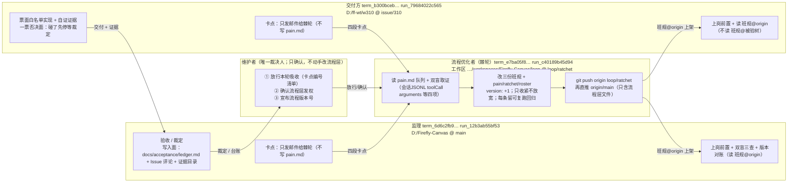

# 流程层口径表与身份登记册（ROSTER）

唯一名册 + 唯一口径表。**单写者：流程优化者（棘轮）**（`单写`）。三方不得写本文件；有异议发邮件给我，由我改。
本文件是三方的称呼、编号、文件指代、版本基准的**唯一真相源**。任何邮件、台账、Issue 评论引用角色或文件，一律按本表写法。

## 1. 口径表（先统一这个，再谈别的）

### 1.1 角色名（规范名 / 唯一别名）

| 规范名（正文只用这个） | 唯一别名 | 职责边界（一句话） | 不得做 |
|---|---|---|---|
| 流程优化者 | 棘轮 | 收卡点、判定入队、把教训固化成可复跑的检查或工具 | 不做验收判定、不改产品代码与测试、不落 triage 标签、不关 Issue、不推 main |
| 监理 | — | 验收与裁定，落台账与 Issue 评论 | 产品代码与测试、流程层文件、推 `main`（产品代码与测试）；台账不可豁免 |
| 交付方 | — | 按票面白名单实现并自证证据 | 一票否决面、流程层文件、`ledger.md`、推 `main` |
| user（原「维护者」已于 2026-11-10 退役，职责合并进棘轮；v5 起称 user） | 无别名 | 最终裁决：产品取舍、合并 `main`、建/退役会话、收发放权 | 不代写监理台账、不改流程 skill（走棘轮） |

不得用的称呼：「优化会话」「监理会话」「交付会话」「那位」「你们这边」——这些词在归因时产生歧义（实测 P-06 归因两轮错记即源于此）。**认人只认 `HANDLE` 与 `SELF_RUN` 编号（`认人认编号`），不认称呼。**

> 「不得做」里凡写「推 `main`」均特指**产品代码与测试**（含 merge 进 `main`）。流程层（`.pi/skills/**`、`docs/acceptance/{pain,ratchet,roster}.md`）由棘轮按 `流程层发权` 直推 `origin/main`；监理写 `docs/acceptance/ledger.md` 并按台账停止条件自推 `origin/main` 属其职权（本轮 `4b3305e` 实测已发生且合规）。措辞口径记入 pain.md **P-33**。

### 1.2 编号与 ID 的规范写法

| 对象 | 规范写法 | 常见错误写法（实测会失败或歧义） |
|---|---|---|
| Orca 终端 | `term_<uuid>`（handle） | `orca terminal rename` 的标题会被 pi 覆盖，不可用作身份 |
| Orca Run | `run_<12位hex>` | — |
| 发件寻址 | `--to run:run_<12位hex>` | `--to run:<hex 不带 run_>` → `run_not_found`；`--to run_<hex>` → `terminal_not_found` |
| 会话逐字记录 | `C:/Users/Administrator/.pi/agent/sessions/<cwd-slug>/<ts>_<uuid>.jsonl` | 按原始行 grep 会把「读邮件」误算成「敲命令」；只查 `toolCall` 的 `arguments` |
| Issue 评论 | `issuecomment-<databaseId>`，引用前先 `gh issue view --json comments` | 凭记忆写 ID |
| 提交 | `<7位sha>`，并写明所在分支（`main` / `loop/ratchet` / `issue/<N>`） | 只写 sha 不写分支（本地 main 与 origin/main 曾差 4 颗） |

### 1.3 文件的唯一指代（同名文件的三份副本必须区分）

| 代号 | 绝对路径 | 谁读它 | 状态 |
|---|---|---|---|
| `班规@origin` | `origin/main:.pi/skills/{acceptance-supervisor,impl-session-contract,process-optimizer}/SKILL.md` | 三方上岗取版本 | **本轮唯一准绳**（`流程契约取法`）；当前 `origin/main` 停在 `7e03237`，尚无流程层 |
| `班规@本地main` | `D:/Firefly-Canvas/.pi/skills/…`（监理与维护者工作区） | 仅维护者合并前后核对 | 已 ff 到 `a6dfa39`（v3） |
| `班规@棘轮` | `C:/Users/Administrator/orca/workspaces/Firefly-Canvas/loop/.pi/skills/…`（分支 `loop/ratchet`） | 只由棘轮写 | 最新 `e66f850`，三份 `version: 3` |
| `班规@被验树` | `D:/ff-wt/w310/.pi/skills/…`（分支 `issue/310`@`16df89a`） | 交付方工作区自带 | **`b2b3399` 时代旧版，不作数**（P-15） |

流程层文件（同样只有棘轮写，其余两方只读）：`docs/acceptance/{pain,ratchet,roster}.md`；监理自有写入面只有 `docs/acceptance/ledger.md`。

### 1.4 版本基准

- 本轮基准值 = **5**（v5 边界令 user m00719，维护者退役、宣布方改为棘轮；本版由棘轮宣布并登记于此）。
- 历史基准（保留供追溯）：本轮之前 = **4**（依原维护者边界令第六条「版本号不是 4 即停」+ 监理即停 msg_b7922fec9543 执行 bump 3→4）；棘轮自测 `origin/main@c53f877` 三份全 `version: 4`；监理 msg_71852e372417、交付方 msg_d52bb7e1a11b 同 sha 互证 → v4 版本门闭合。
- 上岗版本门判据（v5）：**读数等于本节登记的生效值**（宣布方=棘轮），不得填自报值、不得填「读过就行」；在途轮次按 `班规@origin` 当时读到的版本跑完（轮内冻结），新轮开工前必须先读到 5。
- v5 上架自测（棘轮，当场）：三份班规本地 `grep -n "^version:"` 全 = 5；上架后须复测 `MSYS_NO_PATHCONV=1 git show 'origin/main:.pi/skills/<契约名>/SKILL.md' | grep -n "^version:"` 全 = 5，并把 sha 写进 §4 与 §7.1。

## 2. 身份登记册

| ROLE | HANDLE | SELF_RUN | TAB_ID | WORKTREE+分支+HEAD | SKILL_VERSION | 自有写入面 | 禁止面 | 回执时间与来源 |
|---|---|---|---|---|---|---|---|---|
| 流程优化者（棘轮） | `term_e7ba05f8-bf24-49f2-8fdf-ac7edc9ce0f0` | `run_c40189b45d94` | `c0d9ff46-eaf7-4959-a1ca-156c392b4850` | `C:/Users/Administrator/orca/workspaces/Firefly-Canvas/loop` @ `loop/ratchet` @ 见本文件最新 commit | 自写方（不作上岗门读数）；上架自测 = `origin/main@c53f877` → `version: 4` x3 | `.pi/skills/**`、`docs/acceptance/{pain,ratchet,roster}.md`（流程层，可直推 `origin/main`，`流程层发权`） | 产品代码与测试（绝对禁推）、`ledger.md`、triage 标签、Issue 状态、推 `main`（产品代码与测试） | 自报 2026-11-10；上架回执带读数+sha |
| 监理 | `term_6d6c2fb9-4ac0-4fca-a866-be67febbe86e`（verified） | `run_12b3ab55bf53`（verified：`run-show --full` 的 `coordinator_handle` 持久互证，msg_8602b4bdebcf） | `cf524ca6-5cdf-4f7c-8144-baf8c496d202`（UUID） | `D:/Firefly-Canvas` @ `main` @ `a0a8615`（本地读数；`origin/main` 已到 `4b3305e`） | `origin/main@c53f877` → `version: 4` x3（msg_71852e372417，**门过**） | `docs/acceptance/ledger.md`（含按停止条件自推 `origin/main`，实测 `4b3305e`）、Issue 评论、`D:/Firefly-Canvas-evidence/**`、`/tmp/**` | 产品代码与测试（`src/**`、`tests/**`、`tools/**`）、`.pi/skills/**`、`docs/acceptance/{pain,ratchet,roster}.md`、改被验工作树 git 状态、推 `main`（产品代码与测试）、代交付方写实现、关闭 Issue 以外的状态操作 | 回执 `msg_66beb330eb06` + 版本门 `msg_71852e372417` + 台账自落 `msg_b36245b65bb8` |
| 交付方 | `term_b300bceb-cd82-4771-95c8-bb53ba836bca`（verified，terminal 标题「π - w310」互证） | `run_79684022c565`（verified：`run-show --full --json` → `coordinator_handle=term_b300bceb…`，msg_9afaeecb83d4） | `816d78f2-ebdc-4fe7-b6e4-42da96fbf03e`（UUID） | `D:/ff-wt/w310` @ `issue/310` @ `16df89a` | `origin/main@c53f877` → `3:version: 4`（msg_d52bb7e1a11b，**门过**） | 票面白名单（#310：`tests/tabbit_e2e_evidence.py`、`tests/test_quality_gate.py`）、`git commit`（仅 `issue/310`）、Issue 收尾评论、证据目录、编排邮件 | 一票否决面（`tools/quality_gate.py`、`tools/e2e/**`、`.github/**`、`package*.json`、白名单外 `tests/**`）碰=先停等裁定；`.pi/skills/**`；`docs/acceptance/**`；`ledger.md`；推/merge `main`；删 `issue/310`；建 PR；triage 标签；验收判定 | 回执三段 `msg_e9194575efd3`/`msg_94832d53d48f`/`msg_905055031248` + 版本门 `msg_d52bb7e1a11b` |
| user（原维护者会话已退役 2026-11-10，职责合并进棘轮） | `pi_4714c1cd_55fe_4d59_8b81_68ea12b8551b`（退役存档：pi chat 内嵌会话，无 tabId） | `run_b203fe4d1bef`（退役后不再寻址；上报改走本会话或棘轮） | 不适用 | 不适用 | 不适用（版本宣布方=棘轮，见 §1.4） | `main` 合并与发布、`AGENTS.md`、会话建立与退役、发权收权 | 三份班规正文与 pain/roster（走棘轮入册）、不代写监理台账 | 发权原话（m00568）+ 边界令（m00719） |

### 采信规则

1. 未回执的行只作「旧读数」参考，**不得据以定行为主体**（定主体按 P-23 四项取证清单）。
2. 三方上岗回执缺任一项（`ROLE`/`HANDLE`/`SELF_RUN`/`TAB_ID`/`WORKTREE`/`SKILL_VERSION`/`MY_WRITE_SURFACES`/`MY_FORBIDDEN`/`PEERS`）→ 按停止条件处理，不带身份裂缝开工。
3. 回执与我记录的旧读数不一致 → 以回执为准并记一行变更原因。
4. 每轮上岗第一件事：对册；轮内冻结本文件。

## 3. 回执核验记录（2026-11-10 loop-3）

### 3.1 三方九项回执状态

三方回执**齐**：监理 1 封（九项+A/B）、交付方 3 封（1/3 项1-5、2/3 项6-9、3/3 两问）、维护者身份由名册记录。`PEERS` 三方互证一致（handle ↔ run ↔ 工作区，无冲突）。

### 3.2 棘轮自我更正①：`班规@origin` 的真实状态（三方读数互证 + 棘轮复测）

- 复测（棘轮，2026-11-10）：`git rev-parse --short origin/main` = `7e03237`；`git ls-tree -r --name-only origin/main | grep -c "^\.pi/skills"` = **4**；`MSYS_NO_PATHCONV=1 git show 'origin/main:.pi/skills/acceptance-supervisor/SKILL.md' | grep -n "^version:"` → **rc=1（无版本行）**。
- 监理回执（项 6）与交付方回执（项 6）独立给出同一读数：**文件存在、无 version 行**。
- 因此此前「`origin/main` 上没有 `班规@origin`」的措辞**不准**，已改为：**`origin/main` 有旧版班规（无 `version:` 字段），但没有 `docs/acceptance/{pain,ratchet,roster}.md`，也没有 v2/v3 条款**。`流程契约取法` 的 `即停` 判据据此成立：三方从 `班规@origin` 取到的读数（无版本行）≠ 维护者将宣布的值（棘轮侧 v3）→ 三方在流程层上架前不得按 v3 开工。
- git-bash 踩坑（三方各踩一次，命令原文可引）：`git show origin/main:.pi/...` 不带 `MSYS_NO_PATHCONV=1` 时冒号路径被转义 → `fatal: ambiguous argument` / `fatal: invalid object name`。**规范写法**：`MSYS_NO_PATHCONV=1 git show 'origin/main:<path>'`（引号包住）。

### 3.3 棘轮自我更正②：`run-current` 是「按调用方上下文」绑定的，不能用来核实对端绑定（`run-current自上下文`）

- 事实：监理与交付方回执均称「`run-current` 回读 = 我的 run」。但 `run-current` 只能由会话**在自己的终端里**执行才有效；三方互发的「回读非 null」若由收信方代跑，读到的是**收信方自己**绑定的 run。棘轮此前对监理「`run-current` 为 null」的断言也来自同类跨上下文读数，已作废。
- 结论：**对端绑定状态只能凭对端在自己终端里的自证 + `run-list`/`run-show` 的持久字段互证**，不得由第三方代跑 `run-current` 得出。已并入 P-23 取证清单。

### 3.4 棘轮自我更正③：监理写入面含 Issue 评论

监理回执项 7 列 `GitHub Issue 评论`。棘轮此前只把 `ledger.md` 记为监理自有写入面，属登记不全。已补入名册（Issue 评论属监理职权边界第 3 条：只评不改代码）。

### 3.5 gh 在棘轮工作区不可用（`gh主工作区跑`）

`gh issue view 310 --repo zhao1477/Firefly-Canvas` 在 `C:/Users/Administrator/orca/workspaces/Firefly-Canvas/loop` 下报 `GraphQL: Could not resolve to a Repository`；`gh api repos/…/issues/comments` 报 404。同一命令在 `D:/Firefly-Canvas` 下可用（P-20 取证即在该处完成）。规范：**审计类 gh 命令一律在 `D:/Firefly-Canvas` 执行**（`cd D:/Firefly-Canvas && gh …`），或在棘轮侧改用只读网页/`git` 取证。

### 3.6 监理绑定复核结果（P-26 关闭）

监理补证（`msg_8602b4bdebcf`，2026-11-10）：两条命令均在监理自己终端执行——①`orca orchestration run-current --json` → `runId=run_12b3ab55bf53`；②`orca orchestration run-show --id run_12b3ab55bf53 --full` → `coordinator_handle=term_6d6c2fb9-4ac0-4fca-a866-be67febbe86e`。**新可互证字段**：`run-show` 的 `coordinator_handle` 是服务端持久字段，跨会话查它不受「自上下文」限制 → 今后核绑定一律用 `run-show` 的 `coordinator_handle`（`run-current` 只用于自证）。监理行状态：verified。交付方行仍待同类 `coordinator_handle` 互证（已发 msg 询问）。

### 3.7 交付方绑定复核结果 + 读数截断恢复口径（2026-11-10）

- 交付方补证（`msg_9afaeecb83d4`）：`run-show --id run_79684022c565 --full --json` → `coordinator_handle=term_b300bceb-cd82-4771-95c8-bb53ba836bca`（与回执 HANDLE 一致），另附 `created_at=2026-11-10T07:56:21Z`、`updated_at=2026-11-10T08:08:11Z`、`consumer_generation=2`、`legacy=0`。交付方行状态：**verified**。三方绑定全部持久互证完毕。
- 读数口径（`check截断用inbox--full`，交付方自报）：`orca orchestration check` 的正文会被截断（`truncated; --full`），管道处理时易丢全文；**要全文一律 `orca orchestration inbox --full` 或 `check --full`**。`inbox --json` 在含中文正文时曾出现解析中断，解析失败时改用 `inbox --full` 纯文本 + 分段截取。

### 3.8 版本宣布格式（`版本宣布带证据`，P-28）

维护者「同意推流程层 + 同意宣布版本号」≠ 口径已生效。复测（棘轮 2026-11-10，批准当刻）：`git rev-parse --short origin/main` = `7e03237`；`git ls-tree -r --name-only origin/main | grep docs/acceptance` 只有 `ledger.md`；`MSYS_NO_PATHCONV=1 git show 'origin/main:.pi/skills/process-optimizer/SKILL.md' | grep -n "^version:"` → rc=1。合并面 = `origin/loop/ratchet@5820225`，与 `origin/main` 的差异只有 8 个文件：`.pi/skills/{acceptance-supervisor,impl-session-contract,process-optimizer,reasoning-modes}/SKILL.md`、`AGENTS.md`、`docs/acceptance/{pain,ratchet,roster}.md`（零产品代码）。

**生效判据（三方上岗必须逐项核验，缺任一件即停）**：
1. `git fetch origin main && git rev-parse --short origin/main` 读数 ≠ `7e03237`（即流程层已并入）；
2. `MSYS_NO_PATHCONV=1 git show 'origin/main:.pi/skills/<自己契约名>/SKILL.md' | grep -n "^version:"` 有输出且 = 维护者宣布值；
3. 维护者的版本宣布邮件里同时给出上述两条的命令原文与输出（只有「按 v3 干」这类无证据宣布 → 视为未生效，即停上报）。

**名册自身的一致性**：本轮流程层版本号以「`origin/main` 上实际读到的 `version:` 行」为准，不以棘轮支头读数为准；`班规@棘轮@5820225` 现读数 `version: 3`。

### 3.9 交付方「班规@origin 已=3」读数不成立（`读数贴错路径`，2026-11-10）

三方工作区（`D:/ff-wt/w310`、`D:/Firefly-Canvas`、棘轮 loop）的 `origin` 全部 = `https://github.com/miaomiaozii/Firefly-Canvas.git`，`refs/remotes/origin/main` 全部 = `7e03237`（committerdate 2026-11-10 15:45:52 +0800）。三处 `git show 'origin/main:.pi/skills/<契约名>/SKILL.md' | grep -n "^version:"` 均 **无匹配**；`7e03237:.pi/skills/impl-session-contract/SKILL.md` 前 8 行是 `---/name/disable-model-invocation/description/---`，**根本没有 version 行**。
唯一含 `3:version: 3` 的读数是 `a0a8615`（= `D:/Firefly-Canvas` 的**本地 main**，含棘轮推的流程层）。所以交付方 msg_7042f14d178b 报的「origin/main 已=3」是把 `班规@本地main` 当成了 `班规@origin`。
**规范写法（三方必须照抄，不得简写）**：
1. `git fetch origin main`
2. `git rev-parse --short origin/main` → 当前必须是 `7e03237`（v3 未上架前的读数），≠ 宣布值即停
3. `MSYS_NO_PATHCONV=1 git show 'origin/main:.pi/skills/<契约名>/SKILL.md' | grep -n "^version:"` → 未上架前 rc=1
4. 报告里必须同时写第 2 步的 sha。只有 grep 输出没有 sha 的读数一律不采信。

**流程层仍未上架**（截至本轮）：`origin/main` = `7e03237`，`docs/acceptance/**` 只有 `ledger.md`；`loop/ratchet` = `85bdbfd` 是 `origin/main` 的非祖先，合并面 = `git diff --name-only origin/main origin/loop/ratchet` 的 8 个文件。

### 3.10 监理独立复读互证 + 假读数影响面（2026-11-10）

监理四步照抄独立复读（`msg_31214dba38e2`）：`git fetch origin main` → `origin/main=7e03237`；`grep "^version:"` 于 `origin/main:.pi/skills/acceptance-supervisor/SKILL.md` → rc=1；本地 main `a0a8615` 含 `version: 3`（仅本地生效面）。**与棘轮三处互证完全一致 → §3.9 结论 confirmed（两人独立、命令与 sha 齐）**。监理立场：以 `班规@origin` 为准，读不到宣布版本号的对应读数即停，不用本地 main 开工。
影响面核查（按 P-22 归因链要求）：监理声明其全部裁定发生在该假读数之前且依据均带 sha/评论 ID → 假读数未污染任何在途裁定，不需追级。交付方假读数只影响「是否可按 v3 开工」这一条待决判断，已被本轮预警拦下。

### 3.11 消息类型与 Dispatch 权限（`类型需Dispatch`）

`--type escalation`（及 `worker_done`）要求发送方有 active Dispatch，否则报 `error: sender_not_assignee: No active Dispatch belongs to this message sender.`；`--type status` / `question` 无此要求（实测：同一正文 escalation 失败 → status 成功，`msg_ed891ec8b7f3`）。合法取值：`status, dispatch, worker_done, merge_ready, escalation, handoff, decision_gate, question, heartbeat`。**给维护者/跨角色的一般上报一律用 `status`；`escalation` 只在有 Dispatch 的 worker 会话里用**。

## 4. 流程层发权与上架状态（`流程层发权`）

- **谁写谁推**：流程层 = 四份班规（三份角色契约 + 通用层 `.pi/skills/three-role-loop/SKILL.md`，代号 `班规@通用`；通用层不带 `version:` 字段，版本门 grep 只命中三份角色契约）+ `docs/acceptance/{pain,ratchet,roster}.md`。**写入与直推 `origin/main` 由棘轮执行**（流程优化者（棘轮）=term_e7ba05f8-bf24-49f2-8fdf-ac7edc9ce0f0=run_c40189b45d94），维护者只确认（实测口径：「流程的相关的就是你编辑你推送啊，只需要我确认就可以了」）。监理与交付方**不得改班规**，异议走 `pain.md`（邮件上报，不写文件）。
- **发权范围（`发权范围`）**：只有上述流程层文件。产品代码与测试（`src/**`、`tools/**`、`tests/**`、`e2e/**`、`.github/**`、`package*.json`、`uv.lock`、`pyproject.toml`）绝对禁推；`AGENTS.md` 归 user，棘轮持 user 授权时可改并同 commit 上架（`AGENTS写权`，实测：v5 边界令 m00719 后的同步）。
- **收权（`收权`）**：user 一句「流程层不许直推」即回到他合并；他可随时 revert 棘轮提交。
- **上架状态**：**最新已上架 = `origin/main@0bba2ce`（v5）**：`git push origin HEAD:main` → `318c505..0bba2ce`；上架后当场回读三份班规 `^version:` 全 = 5（process-optimizer `4:version: 5`、acceptance-supervisor `3:version: 5`、impl-session-contract `3:version: 5`）；产品面 grep 为空（exit 1）；`check_tables.py` exit 0。上架面：`.pi/skills/{acceptance-supervisor,impl-session-contract,process-optimizer}/SKILL.md`、`AGENTS.md`（`AGENTS写权`，user m00719 授权）、`docs/acceptance/{pain,ratchet,roster}.md`。**通用层 skill 不在仓内**（`班规@origin:.pi/skills/three-role-loop/SKILL.md`，本机全局目录，无 git 版本控制——已知局限，user 可裁决是否进仓）。
  历史：**已上架 = `origin/main@cac1818`**（棘轮 2026-11-10 实推并回读：`git push origin <sha>:main` → `7e03237..cac1818`；`git rev-parse --short origin/main` = `cac1818`；三份班规在 `origin/main` 上均 `version: 3`；`docs/acceptance/{ledger,pain,ratchet,roster}.md` 均已在 `origin/main`）。本轮上架面：`.pi/skills/{acceptance-supervisor,impl-session-contract,process-optimizer,reasoning-modes}/SKILL.md`、`AGENTS.md`（这两处是 loop-2 期间监理会话在本地 main 上的改动，随本次快进上架，无产品代码）、`docs/acceptance/{pain,ratchet,roster}.md`。

## 5. 流程全景（一图）

| 载体 | 谁能写 | 谁推 | 生效条件 |
|---|---|---|---|
| 产品代码与测试（`src/tools/tests/e2e/.github`） | 仅交付方（票面白名单内，仅 `issue/<N>`） | 交付方推 `issue/<N>`；`main` 由监理裁定 + 维护者决定合并 | 监理台账 PASS + 门禁复跑 |
| `docs/acceptance/ledger.md` | 仅监理 | 监理 | 上岗台账不可豁免 |
| 流程层（三份班规 + pain/ratchet/roster） | 仅棘轮 | 棘轮直推 `origin/main` | 维护者确认 + 版本号宣布 + 三方回执版本一致 |
| `AGENTS.md` | user（棘轮仅在 user 授权时可改，`AGENTS写权`） | user，或棘轮持授权同 commit 上架 | — |

### 5.1 上架实测与 git-bash 坑（`推main用sha`）

- 坑：棘轮工作区里 `git branch -f main <sha>` 报 `fatal: cannot force update the branch 'main' used by worktree at 'D:/Firefly-Canvas'`（`main` 被主工作区占用）。**规范推法**：`git push origin <sha>:main`（不碰本地分支），推后必验 `git fetch origin main && git rev-parse --short origin/main`。
- 主工作区 `D:/Firefly-Canvas` 的本地 `main` 现在是 `a0a8615`，落后于 `origin/main@cac1818`。监理要取本轮班规**不要切分支**：用 `MSYS_NO_PATHCONV=1 git show 'origin/main:.pi/skills/acceptance-supervisor/SKILL.md'`（`流程契约取法`），或在主工作区 `git merge --ff-only origin/main`（需维护者同意，监理不得自己动被验树 git 状态）。

### 5.2 版本门口径（`版本门读数=宣布值`，v4 追加，P-32）

- **任何**流程层改动（哪怕只补一条款、改一句措辞）必须在**同一 commit** 内把受影响 skill 的 `version:` +1；禁止「同版本内补条款」这种说法——它曾让 `origin/main` 读数停在 3 而维护者宣布 4。
- 上岗版本门的判据是**读数等于维护者本轮宣布值**，不是「读过就行」。监理的即停（msg_b7922fec9543）是正确行为，不是阻力。
- 上架回执正文必须带两样：`grep "^version:"` 在 `origin/main` 上的读数原文 + 上架 sha。缺一视为未上架。
- 本轮实测（v4 上架，棘轮回读）：`git rev-parse --short origin/main` = **`6c5e546`**；`MSYS_NO_PATHCONV=1 git show 'origin/main:.pi/skills/{acceptance-supervisor,impl-session-contract,process-optimizer}/SKILL.md' | grep "^version:"` → 三行全 `version: 4`；`git ls-tree -r --name-only origin/main | grep docs/acceptance` → `ledger.md pain.md ratchet.md roster.md`。生效三判据全绿（P-32 结案）。

## 6. v4 版本门闭合与台账自落（2026-11-10 loop-3）

### 6.1 版本门闭合（`版本门读数=宣布值`）

| 方 | 当场读数（原文摘要） | 所在 sha | 判定 |
|---|---|---|---|
| 监理 | 三份班规 `grep -n "^version:"` 全 = `version: 4` | `origin/main=c53f877` | 门过（msg_71852e372417） |
| 交付方 | 四步复读：`git rev-parse --short origin/main` = `c53f877`；`grep -n '^version:'` → `3:version: 4`；`ls-tree` 四台账在册 | 同上 | 门过（msg_d52bb7e1a11b） |
| 棘轮 | `git fetch origin main` → `c53f877`；三份分别 `3:version: 4`/`3:version: 4`/`4:version: 4` | 同上 | 上架方自测 |

三方读数互证一致 → 即停解除，本轮版本基准 = **4**。

### 6.2 台账停止条件解除（监理自落，合规）

- 监理以 plumbing 直建 commit `4b3305e`（`c53f877..4b3305e` 已推 `origin/main`），**未动被验树工作区与 HEAD，不含任何产品文件**（棘轮复核：`git show --stat 4b3305e` → 仅 `docs/acceptance/ledger.md | 3 +++`）。
- 行内容九列：`2026-11-10 | #310 | D:/ff-wt/w310 | 验收第二轮 | 0 | none | 0 | PASS_WITH_NOTES | D:/Firefly-Canvas-evidence/run_2026-11-10T09-10-15Z`；表下注记含「(v3) 为棘轮误标，v4 上架后更正」半句。
- 结论：`ledger.md` 是监理自有写入面，schema 归监理定，棘轮不裁定不代笔；监理自推 `origin/main` 属台账停止条件要求的动作，不属「推 main」禁区（见 P-33）。

### 6.3 P-33（禁止面措辞口径，已入 pain.md）

「推 `main`」这种笼统写法把两种行为混成一件：产品代码与测试推 `main`（绝对禁止）与流程层/台账按各自职权推 `origin/main`（本轮已实测发生且合规）。名册 §1.1、§2 各行已改为「推 `main`（产品代码与测试）」。三份班规正文的同步改动必须 bump `version: 4 → 5`（`版本门读数=宣布值`），因此**不在本轮轮内推**：等维护者宣布新值后于轮间生效（轮内冻结）。

## 7. v5 边界令（user 2026-11-10，维护者角色退役）

**裁决（user 原话，m00719 摘要）**：「没有维护者了，原来的维护者那个会话已经退役了，所有的职责合并进你这个流程优化者了」；并给出六条边界。三方契约同步 bump 到 **version: 5**（宣布方改为棘轮，登记在本节与 §1.4）。

| # | 边界（v5 硬口径） | 落点 |
|---|---|---|
| 1 | 监理只负责监管 worker、判定 Issue 是否完成并**书面指示工人推送与关闭**、发自己卡点给棘轮但**不改**；可用 `/code-review` 等技能辅助 | 监理契约「v5 角色边界」+「完成指示令」 |
| 2 | 工人只负责项目干活、被监理监管、卡点发棘轮但**不改**；用 `/qa`、`/implement` 等技能辅助 | 工人契约「v5 角色边界」 |
| 3 | 棘轮只解两方卡点、优化流程 skill、**user 决断后推送更新**；不碰监理与工人的活；**不频繁发消息污染他们上下文**；不让两方碰流程的事；等他们做完手头工作再一次性通知读新班规 | 棘轮契约 §1 边界 + §5 信箱协议 + §7 轮间生效 |
| 4 | 会话存续：user 建 worker 时同步在当前项目工作区建监理与棘轮会话，**Orca 显式可见**，直到 user 让某个会话退役；**同一时间一个项目工作区三个角色各只存在一个** | 三份契约「同名角色唯一性」+ 停止条件 |
| 5 | 各角色会话相对独立，各做各的卫生，不遗留垃圾 | 通用层 §8 |
| 6 | 消息要有时间轴、**增量读取**，不得每次全量读塞爆上下文 | `信箱增量`（通用层 §4 + 三份契约） |

- **技能自选（`技能自选`）**：skill 由会话自行决定调用，契约只保证硬口径不被跳过（user：「skill 这个可以让会话自行决定调用，不必拘泥我上面的举例」）。
- **维护者退役后的口径映射**：原「升级给维护者」→ 升级 **user**（抄送棘轮）；原「维护者合并 main」→ **user 决定合并**（监理判定通过后指示工人 push，merge 由 user 做）；原「维护者宣布版本号」→ **棘轮宣布并登记在 §1.4**；`AGENTS.md` 归 user。
- **通用层（P-39）**：跨项目可复用的规则抽到 `班规@origin:.pi/skills/three-role-loop/SKILL.md`（user 裁决：这是一份通用 skill）；项目三份契约只写本项目参数与例外，冲突以项目契约为准。
- **待生效通知（v5）**：按边界 3，生效通知在**轮间**发——监理与工人当前手头的轮次跑完后，由棘轮各发一封（正文=版本号 5 + sha + 该方需改变的动作 ≤5 条），回执一行 `已读 version:5 @<sha>`。**在此之前他们按 version:4 口径跑完手头工作。**

### 7.1 v5 生效状态

| 项 | 状态 |
|---|---|
| 三份契约 `version: 5` | **已上架**：`origin/main@f1a270f`（含通用层进仓 P-40），当场回读三份全 `version: 5`；`git ls-tree origin/main .pi/skills/three-role-loop/SKILL.md` 非空；全局副本已移出加载路径（备份 `C:/Users/Administrator/AppData/Local/Temp/three-role-loop-global-backup`）（§4） |
| 生效通知 | **已发（user 批准 m00809「1、2 按推荐」）**：监理 `msg_637dc8b6366d`、工人 `msg_c5e01278589b`（各一封，5 条动作 + 一行回执要求）。回执待落，到后记本表 | 
| 回执 | 监理：待；工人：待 |
| 监理/工人当前应按哪版跑 | 手头在途轮次按 `班规@origin` 读到的 version:4 跑完；新轮开工前先读 5 |
